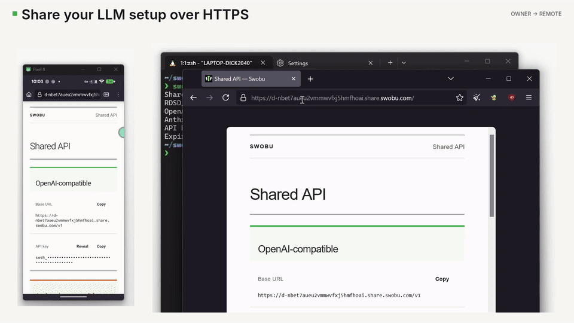
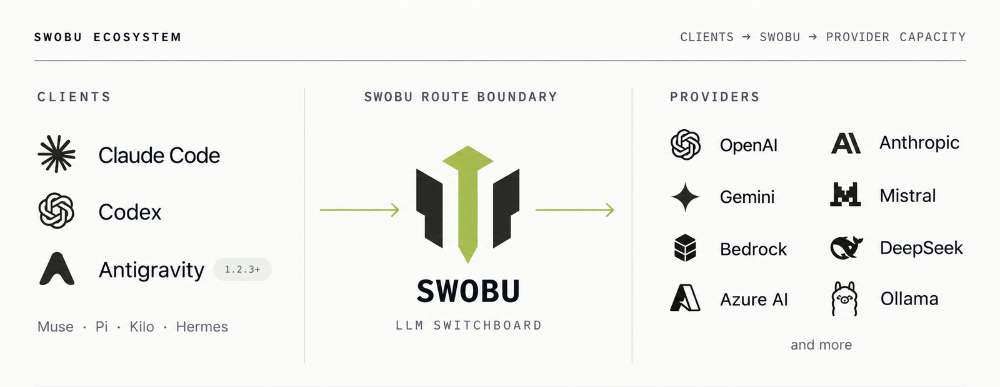

# [Swobu](https://swobu.com/) — LLM Switchboard

**English** · [简体中文](README.zh-CN.md) · [日本語](README.ja.md) · [Português (Brasil)](README.pt-BR.md) · [Bahasa Indonesia](README.id.md) · [한국어](README.ko.md) · [Русский](README.ru.md) · [Español](README.es.md) · [Українська](README.uk.md)

**Pool LLM capacity you already have.**

Put provider accounts, cloud regions, hosted endpoints, and local GPUs behind
stable model names. Your agents keep one endpoint while Swobu handles routing,
runtime fallback, and protocol translation.

Workspaces expose Models, MCP, and Search through reusable Connections.
Principals receive the Services they need; publishing a Workspace makes those
Services reachable with their existing credentials and limits. Activity shows
what actually ran. The source tree uses the Web Operator; the install below
uses the current published release.

[Documentation](https://swobu.com/docs/) · [Quickstart](https://swobu.com/docs/start/first-route/) · [VS Code](https://marketplace.visualstudio.com/items?itemName=swobu.swobu&utm_source=swobu_docs&utm_medium=referral&utm_campaign=vscode_extension) · [Releases](https://github.com/swobuforge/swobu/releases)

<p align="center">
  
</p>

<p align="center">
  <picture>
    <source media="(max-width: 600px)" srcset="./assets/readme/ecosystem-mobile.png">
    
  </picture>
</p>

<p align="center"><sub>Compatibility shown, not partnership. Support varies by provider and runtime.</sub></p>

---

## Install

macOS, Linux, or WSL:

```bash
curl -fsSL https://swobu.com/install.sh | sh
```

Windows PowerShell:

```powershell
irm https://swobu.com/install.ps1 | iex
```

After installation, configure a Workspace and model route, then preview the
application configuration before applying it. Use `swobu principal list` (or
`swobu principal list --json` for automation) to find an existing Principal
with Models access to the Workspace, then replace `<principal-id>` below.

```bash
swobu connect claude --dry-run --workspace coding --model coding --principal '<principal-id>'
swobu connect codex --dry-run --workspace coding --model coding --principal '<principal-id>'
```

These commands preview without writing. Use the [reviewed Connect workflow](docs/clients/admin-mcp.md) to apply with a private intent file and local confirmation. Muse, pi, Kilo, and Hermes are also supported. Antigravity CLI 1.2.3 compatibility is separately qualified; after confirmed Connect apply, open a new terminal and run ordinary `agy`.

[Build your first route in five minutes →](https://swobu.com/docs/start/first-route/)

---

## Route once. Change the capacity underneath.

A Swobu **route looks like a model name** to your agent. It is the stable name
the agent already sends while Swobu owns the configured capacity behind it.

```text
agent: model = coding
          │
          ▼
        Swobu
          │
          ├─ Azure AI / region A
          ├─ Azure AI / region B
          ├─ AWS Bedrock
          └─ Ollama
```

Routes can pool provider accounts, regions, hosted endpoints, local servers, and models. Peer target order changes across attempts; fallback tiers define what happens after a real attempt fails. Swobu does not inspect live quota, price, health, or latency.

**Runtime fallback, not preflight.** Swobu does not preflight compatibility. It
sends the real request to the configured target, and a failed attempt can
advance to the next target in the route.

**Protocol translation at one boundary.** Current protocol families include OpenAI Responses, OpenAI Chat Completions, Anthropic Messages, and Gemini Interactions. Translation occurs where the requested semantics are representable.

[How routing works →](https://swobu.com/docs/) · [Capability matrix →](https://swobu.com/docs/)

---

## Publish a Workspace with controlled access

Open the Workspace’s Connect page in the local Web Operator and select
**Publish via relay**. Remote clients use that Workspace’s address and
credential. Its current Service permissions and limits still apply; provider
credentials and application TLS keys stay on your Node.

Select **Unpublish** to remove public reachability, or revoke a credential to
withdraw that client’s access. [Publish a Workspace →](https://swobu.com/docs/concepts/sharing/)

---

## Local-first

Swobu runs locally and exposes the endpoint your agents use. Provider credentials stay at that boundary. Requests leave your machine when a hosted target is selected. No Swobu account is required for local use. Operational telemetry is deliberately limited and can be disabled.

[Security & privacy →](https://swobu.com/docs/)

---

## Releases

Swobu publishes versioned Linux, macOS, and Windows binaries with SHA-256 checksums.

[Latest release →](https://github.com/swobuforge/swobu/releases/latest)

Build from source:

```bash
git clone https://github.com/swobuforge/swobu.git
cd swobu
make build
./.out/swobu --version
```
